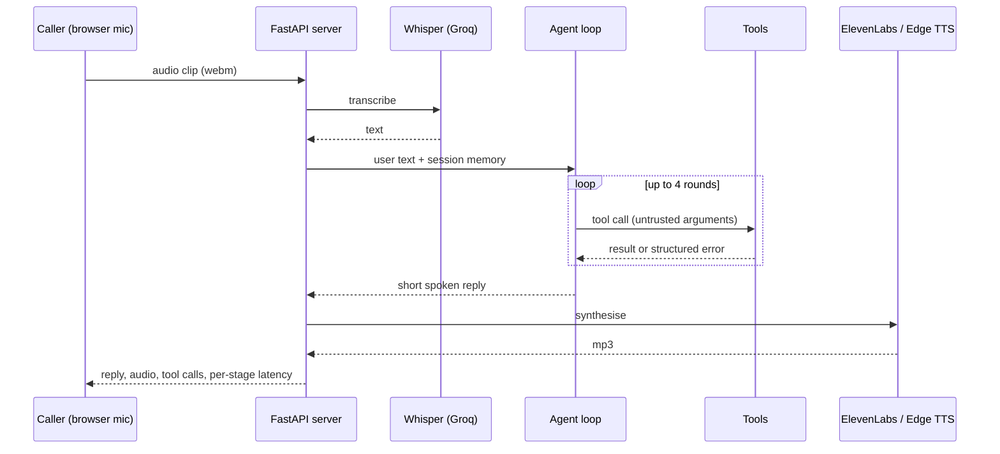

# VoiceDesk: a voice customer-support agent with real tools and real guardrails

Speak to it, it listens (**Whisper**), thinks with a **tool-calling LLM**, checks real data, and answers out loud (**ElevenLabs**, or a free fallback voice). It can look up orders, search policies, take callback requests and **hand off to a human**, and it is built so it cannot leak another customer's order or loop forever.

Everything runs on free tiers: a free Groq key (LLM + Whisper) and the ElevenLabs free plan. No key is needed to run the tests.

## What it does



**Tools the model can call**

| Tool | What it does | Safety property |
|---|---|---|
| `lookup_order` | status, tracking, ETA | needs order number **and** matching e-mail; "wrong e-mail" and "no such order" give the identical answer, so order numbers cannot be probed |
| `search_faq` | returns/delivery/warranty policies | returns top-3 candidates; says "no match" rather than guessing, so the agent offers a callback |
| `get_store_hours` | opening hours, open now | clock is injectable (deterministic tests) |
| `request_callback` | stores a ticket in SQLite | validates name, phone and reason |
| `escalate_to_human` | flags the call for handoff | also triggered automatically if the tool loop runs away |

**Engineering details**

- **Bounded agent loop**: max 4 tool rounds, then it apologises, escalates and stops.
- **Untrusted tool arguments**: arguments are parsed defensively, unknown tool names (including attribute names like `db` or `__init__`) are rejected, wrong/extra arguments come back to the model as a clear error instead of crashing.
- **Voice-friendly output**: replies are stripped of markdown, URLs, emoji and truncated at a sentence boundary before synthesis.
- **Session memory** with TTL and a hard cap, trimmed only at user-turn boundaries so a tool call is never separated from its result.
- **Graceful degradation**: if text-to-speech fails (quota, outage) the caller still gets the text reply plus a `tts_error`; STT failures return a clean 503 naming the service.
- **Abuse protection**: per-client rate limit, 5 MB audio cap, strict session-id format, PII redaction (e-mails, phone numbers, long numbers) before anything is logged.
- **Per-stage latency** (`stt`, `llm`, `tts`, `total` in ms) is returned with every response and shown in the UI.
- **ElevenLabs client**: exponential backoff on 429/5xx, immediate clear errors for a bad key or exhausted quota.

## Measured quality: FAQ retrieval

`python eval_faq.py` on the bundled policy FAQ (8 policies). Settings were chosen on the 14 "tuning" questions; the 12 "held-out" questions were written afterwards. The model reads every candidate, so **top-3 recall** is what drives answer quality.

| Search mode | tuning top-1 | tuning top-3 | held-out top-1 | held-out top-3 | nonsense correctly empty |
|---|---|---|---|---|---|
| keyword (BM25 + stemming + synonyms) | 0.71 | 0.93 | 0.58 | 0.83 | 4/4 |
| hybrid (BM25 + embeddings, optional) | 0.71 | 1.00 | 0.67 | **1.00** | 4/4 |

Honest reading: hand-tuned keyword search is brittle on paraphrases ("the glass was cracked" does not contain "damaged"); adding embeddings fixed every held-out miss. The question sets are small (12 and 14), so treat this as a sanity check, not a benchmark. Install `sentence-transformers` to enable the hybrid mode automatically.

## What is and is not verified

- **Verified:** 27 offline tests (scripted fake LLM, fake STT/TTS, mocked HTTP): tools and their security properties, the agent loop and its caps, guardrails, the Whisper and ElevenLabs request shapes and error handling, every API endpoint, rate limiting and session expiry. The web UI was exercised in a real browser against the real server with a scripted model.
- **Not verified here:** calls to the live Groq, Whisper and ElevenLabs services, and the microphone round trip, because those need your keys and a mic. Latency numbers are therefore not claimed; run the app and read the per-stage badges.

## Quick start

```bash
python -m venv venv && venv\Scripts\activate
pip install -r requirements.txt
pytest -q                                  # 27 tests, about 2 seconds, no keys needed
python eval_faq.py                         # FAQ retrieval numbers

copy .env.example .env                     # add GROQ_API_KEY (and ELEVENLABS_API_KEY for premium voices)
uvicorn app:app --reload                   # open http://localhost:8000 and press the microphone
```

Try: "Where is order A1001? My email is maria@example.com", "How long do I have to return something?", "Is the store open now?", "This is ridiculous, get me a person."
Demo data (fictional): `data/shop.json`, `data/faq.md`.

## Project structure

```
voicedesk/agent.py       tool-calling loop, memory, history trimming, fallbacks
voicedesk/tools.py       order lookup, FAQ search (BM25 + optional embeddings), hours, callbacks, escalation
voicedesk/clients.py     Groq chat + Whisper, ElevenLabs and Edge TTS clients
voicedesk/guardrails.py  speech sanitising, input limits, PII redaction
voicedesk/server.py      FastAPI factory, sessions, rate limiter, endpoints
static/index.html        push-to-talk UI with tool chips and latency badges
eval_faq.py  eval/       retrieval evaluation and question sets
tests/                   27 offline tests
```

## Limitations and next steps

- One utterance per request (record, send, reply); no streaming or barge-in yet. A WebSocket pipeline with streaming TTS would cut perceived latency.
- Demo data is a JSON file and an in-memory index; swap `ToolBox` for your order system and CRM.
- Authentication is by order number plus e-mail only. A real deployment should add a stronger identity check before revealing order details.
- Sessions live in memory; use Redis for multiple server instances.

## Tech

Python, FastAPI, Groq (tool calling + Whisper), ElevenLabs, edge-tts, rank-bm25, optional sentence-transformers, SQLite, pytest.
